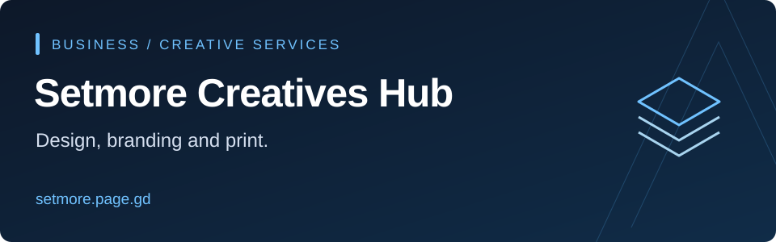
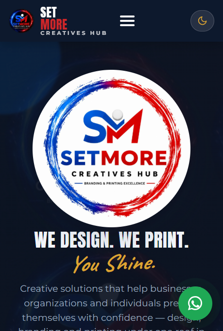

<p align="center">
  
</p>

# Setmore Creatives Hub

**A business website that brings a creative studio's services, work and enquiry channels together.**

[Visit the live website](https://setmore.page.gd) · [View the portfolio](https://setmore.page.gd/portfolio.php) · [Developer profile](https://github.com/obash11)

## Overview

Setmore Creatives Hub is a Nairobi-based branding and printing business. I built its website to introduce the studio, explain its services, showcase its work and give prospective clients clear ways to request a quote.

**Developer:** [Obadiah Otwori](https://github.com/obash11)<br>
**Live domain:** [setmore.page.gd](https://setmore.page.gd)<br>
**Repository type:** Project showcase — documentation and screenshots, not application source code.

[Case study](#case-study) · [Feature guide](#public-feature-guide) · [Preview](#mobile-preview) · [Demo routes](#guided-demo-routes) · [FAQ](#frequently-asked-questions) · [Feedback](#feedback-and-contributions)

## Case study

**The need:** A creative business needs to explain what it offers, show its work and give prospective customers a straightforward next step.

**The approach:** Connect a brand-led introduction with a structured service catalogue, visual portfolio and enquiry links. Present the studio's process and package information alongside its work.

**The design focus:** A strong visual identity, clear service groupings and repeated contact entry points, including WhatsApp and quote requests.

**The delivered work:** A live business website at `setmore.page.gd`. This case study describes the website rather than claiming measured sales, enquiry conversion or client totals.

## Public feature guide

| # | Feature | What visitors can find |
| --- | --- | --- |
| 1 | Brand-led homepage | Studio identity, introductory content and primary calls to action |
| 2 | Service catalogue | Branding, graphic design, print, event branding, apparel and custom services |
| 3 | Portfolio | A dedicated work page and featured imagery |
| 4 | Quote enquiry | A contact/quote page linked from the homepage |
| 5 | Service-specific links | Enquiry links carrying a selected service into the contact-page URL |
| 6 | WhatsApp contact | Direct chat links and a floating contact shortcut |
| 7 | Phone and email links | Click-to-call and email entry points |
| 8 | Company profile | A downloadable company-profile document |
| 9 | Package overview | Starter, Growth and Full Brand package descriptions |
| 10 | Process guide | A four-step explanation from idea to delivery |
| 11 | FAQ section | Expandable answers to common service questions |
| 12 | Theme choices | Light, dark and dusk display controls |

These entries describe the public interface. Owner-only administration and customer information are not part of this showcase.

## Mobile preview

<p align="center">
  <a href="https://setmore.page.gd"></a>
</p>

<sub>Screenshot captured from the public website on 12 November 2026. The live page may change.</sub>

## Project focus

- Present branding, design and print services in a clear, recognisable visual identity.
- Help prospective clients move from viewing work to making an enquiry.
- Bring service details, portfolio content and contact information into one website.

## Explore the website

- [About the studio](https://setmore.page.gd/about.php)
- [Services](https://setmore.page.gd/services.php)
- [Portfolio](https://setmore.page.gd/portfolio.php)
- [Contact and quotes](https://setmore.page.gd/contact.php)

## Guided demo routes

| Visitor | Suggested route |
| --- | --- |
| New customer | [Home](https://setmore.page.gd) → explore services → review work → open the quote page |
| Business owner | [Services](https://setmore.page.gd/services.php) → compare branding options → review the company profile |
| Event organiser | Explore event/corporate branding → view the portfolio → inspect the contact options |
| Portfolio reviewer | Review the homepage hierarchy → try the theme control → browse service and portfolio pages |

A portfolio tour does not require sending a quote request or a WhatsApp message. Submit enquiries only when you genuinely want to contact the business.

## Frequently asked questions

<details>
<summary><strong>Is this the Setmore appointment-scheduling product?</strong></summary>

No. This showcase is for **Setmore Creatives Hub**, the Nairobi branding and printing business at `setmore.page.gd`.

</details>

<details>
<summary><strong>Is the production application included?</strong></summary>

No. This repository documents the live website and includes presentation assets and documentation checks, not its production source or customer data.

</details>

<details>
<summary><strong>Where do I ask for a design or printing quote?</strong></summary>

Use the contact page or the business contact links on the live website. GitHub issues are for website/showcase feedback, not orders or private customer requests.

</details>

<details>
<summary><strong>Can I reuse the branding or portfolio artwork?</strong></summary>

Do not assume that public display grants reuse rights. Ask the relevant rights holder before reusing logos, photographs, artwork or other brand materials.

</details>

## Feedback and contributions

[Report a website/showcase issue](https://github.com/obash11/setmore-creatives-hub/issues/new?template=bug_report.yml) · [Suggest an improvement](https://github.com/obash11/setmore-creatives-hub/issues/new?template=improvement.yml)

Read the [contribution guide](CONTRIBUTING.md) and [privacy/security reporting guidance](SECURITY.md) before sharing screenshots or reports.

### Check the documentation locally

With Node.js 18 or newer installed, run this command from the repository folder:

```sh
node .github/scripts/check-showcase.cjs
```

The checker validates local document/image links, presentation assets, issue-form JSON/YAML and permitted file types. It does not submit quote requests or test customer workflows.

## Repository scope

This is a **portfolio showcase**, not an installable release or an open-source copy of the production system. It contains documentation, presentation assets and a documentation-checking utility. Production application code, credentials and customer records are not included.

---

Built by **[Obadiah Otwori](https://github.com/obash11)**. Also explore **[JIAAD Foundation](https://github.com/obash11/jiaad-foundation)**.
